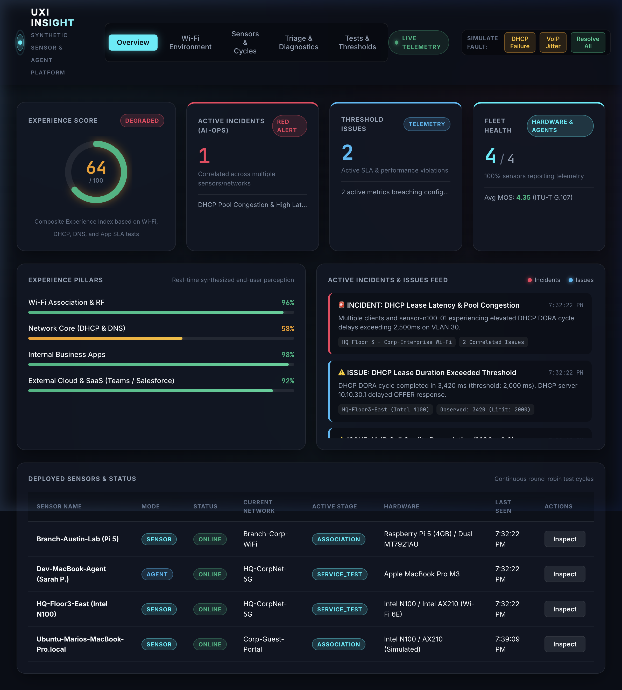

# HPE Aruba UXI Clone — Synthetic Network & User Experience Insight Platform

A self-hosted, enterprise-grade **Client** (sensor/agent daemon) and **Server** (dashboard + PostgreSQL time-series + AIOps incident engine) that replicates the functionality and visual aesthetics of **HPE Aruba Networking User Experience Insight (UXI / Cape Networks)**.




---

## ⚡ Key Capabilities

### 1. The Client (Ubuntu Server 24.04 / 26.04 LTS)
- **Sensor Mode**: Owns a dedicated Wi-Fi test interface (e.g. Intel AX210 or MediaTek MT7921AU); runs a continuous **10-step round-robin test cycle** across up to 4 configured networks (1 Ethernet + up to 3 Wi-Fi SSIDs):
  1. **AP Scan**: BSSIDs, RSSI, SNR, channel utilization, QBSS client counts.
  2. **SSID Check**: Verifies configured SSIDs are beaconing.
  3. **AP Association**: Direct `wpa_supplicant` timing measurement.
  4. **Allocate IP (DHCP)**: Full DORA cycle timing and lease acquisition.
  5. **Gateway Reachability**: ICMP ping and ARP latency.
  6. **Primary DNS**: Resolves internal control hosts (e.g. Infoblox/Bind).
  7. **Secondary DNS**: Resolves public resolver (e.g. Google 8.8.8.8).
  8. **External Connectivity**: HTTP GET check to cloud endpoints.
  9. **Application & Service Tests**:
     - **VoIP MOS**: ITU-T G.107 E-Model MOS calculation (1.0 – 5.0) from jitter, latency, and packet loss.
     - **Webserver / SaaS**: HTTP status and TLS SSL certificate expiration monitoring (Salesforce, Slack).
     - **Throughput**: iPerf3 bandwidth benchmarking.
  10. **Release & Deauth**: Releases lease and advances to the next network.
- **Agent Mode**: Background non-disruptive agent for employee laptops; skips Wi-Fi churn and tests gateway, DNS, and applications every 5 minutes.
- **Store-and-Forward**: Local persistent queue buffers test telemetry if server/backhaul drops, flushing automatically upon restoration.
- **Automated Root-Cause Triage**: In-line failure replayer with traceroute hops, raw Linux terminal command captures (`iw`, `dhclient -v`, `dig`), and wired Ethernet cross-checks.

### 2. The Server & Web Dashboard (Node.js + PostgreSQL)
- **Time-Series Storage**: PostgreSQL schema storing sensors, networks, test definitions, metrics, issues, incidents, and triage dumps.
- **Zero-Config Dual-Mode DB**: Connects to native PostgreSQL (`pg.Pool`) when configured via `DATABASE_URL`, or runs embedded PostgreSQL WASM (`@electric-sql/pglite`) for instant local development.
- **Threshold Engine**: Evaluates metrics against enterprise SLAs (DHCP > 2s, DNS > 100ms, MOS < 3.8).
- **AIOps Incident Engine**: Groups correlated issues across sensors, networks, and services into high-level **Red Incidents** (UXI convention: Issues = Blue, Incidents = Red).
- **Real-Time Telemetry**: Server-Sent Events (SSE) stream live sensor cycle progression and metric updates without full-page reloads.
- **Modern Glassmorphic Dark-Mode UI**:
  - Animated SVG **Experience Score Donut** (0–100).
  - Multi-band **2.4 GHz / 5 GHz / 6 GHz (Wi-Fi 6E)** RF spectrum channel heatmaps and AP vendor identification (Aruba, Cisco, Mist, Extreme).
  - Interactive **10-Step Cycle Visualizer**.
  - **Linux Diagnostic Terminal Emulator** with raw diagnostic traces and hop path analysis.
  - Interactive **Fault Simulator Toolbar** (inject DHCP failure or VoIP jitter with 1 click).

---

## 🚀 Quickstart (Local Development & Demo)

### 1. Start the Server & Dashboard
```bash
# Clone and enter workspace
cd /path/to/vibe-app

# Install dependencies
npm install

# Start the Node.js server (runs on port 3000 with auto-migrating embedded PostgreSQL)
npm run server
```
Open your browser to: **[http://localhost:3000](http://localhost:3000)**

### 2. Run the Sensor Client
In a separate terminal window:
```bash
# Run in simulation mode (ideal for macOS, WSL, or non-root testing)
npm run client:simulate

# Or run in passive agent mode
npm run client:agent
```
Watch the dashboard update in real time as the client executes its 10-step round-robin test cycles!

---

## 🐧 Hardware Deployment on Ubuntu Server LTS

Target hardware: **Intel N100 mini PC** with **Intel AX210** (Wi-Fi 6E M.2 card) or **Raspberry Pi 5** with **MediaTek MT7921AU** USB adapter.

### One-Line Automated Setup
Run the setup script with root permissions:
```bash
sudo bash client/install-ubuntu.sh wlan1 http://<YOUR_DASHBOARD_IP>:3000
```
This automated script:
1. Installs native packages: `iw`, `wpasupplicant`, `isc-dhcp-client`, `iperf3`, `mtr-tiny`, `tcpdump`, `dnsutils`.
2. Marks the test interface (`wlan1`) as **unmanaged** in `/etc/NetworkManager/conf.d/99-uxi-unmanaged.conf` so management traffic stays intact on `eth0`.
3. Installs and starts the systemd service `/etc/systemd/system/uxi-sensor.service`.

Check sensor service status:
```bash
sudo systemctl status uxi-sensor
sudo journalctl -u uxi-sensor -f
```

---

## 🐳 Docker Compose Deployment (Server + PostgreSQL)

To deploy the server and a dedicated PostgreSQL 16 Alpine container:

```bash
docker compose up -d
```

This starts:
- `uxi-postgres`: PostgreSQL 16 container with persistent volume `uxi_pg_data` on port `5432`.
- `uxi-server`: Node.js backend & dashboard container on port `3000`.

---

## 📡 REST API Reference

| Endpoint | Method | Description |
|---|---|---|
| `/api/overview` | `GET` | Experience score, online sensors, active incidents & issues |
| `/api/sensors` | `GET` | List of sensors, hardware info, active stage, cycle count |
| `/api/sensors/register` | `POST` | Sensor heartbeat and registration |
| `/api/telemetry/stage` | `POST` | Sensor cycle stage update (`ap_scan`, `dhcp`, etc.) |
| `/api/telemetry/results` | `POST` | Ingest test results; triggers threshold & incident engine |
| `/api/telemetry/wifi` | `GET`/`POST`| Ingest / query 2.4/5/6 GHz Wi-Fi environment telemetry |
| `/api/issues` | `GET` | List active SLA threshold violations (Blue) |
| `/api/incidents` | `GET` | List AIOps correlated incidents (Red) |
| `/api/triage` | `GET`/`POST`| Ingest / inspect automated root-cause triage reports |
| `/api/triage/:id` | `GET` | Fetch specific triage report with terminal output and hops |
| `/api/simulate-degradation` | `POST` | Fault injection (`dhcp_timeout`, `voip_jitter`, `clear`) |
| `/api/events` | `GET` | Real-time Server-Sent Events (SSE) telemetry stream |

---

## 🔬 ITU-T G.107 VoIP MOS Formula

The client implements the standard telecommunications transmission rating factor:
$$R = 93.2 - I_d - I_e$$
where $I_d$ is the delay impairment factor (one-way delay = $\text{RTT}/2 + 2 \times \text{jitter}$) and $I_e$ is the equipment packet loss impairment factor:
$$I_e = 30 \ln\left(1 + 15 \times \frac{P_{\text{loss}}}{100}\right)$$
The resulting Mean Opinion Score (MOS) is mapped to standard 1.0 – 4.5 boundaries:
$$\text{MOS} = 1 + 0.035 R + R(R - 60)(100 - R) \times 7 \times 10^{-6}$$
Scores $\ge 3.8$ indicate enterprise-grade voice transmission.
