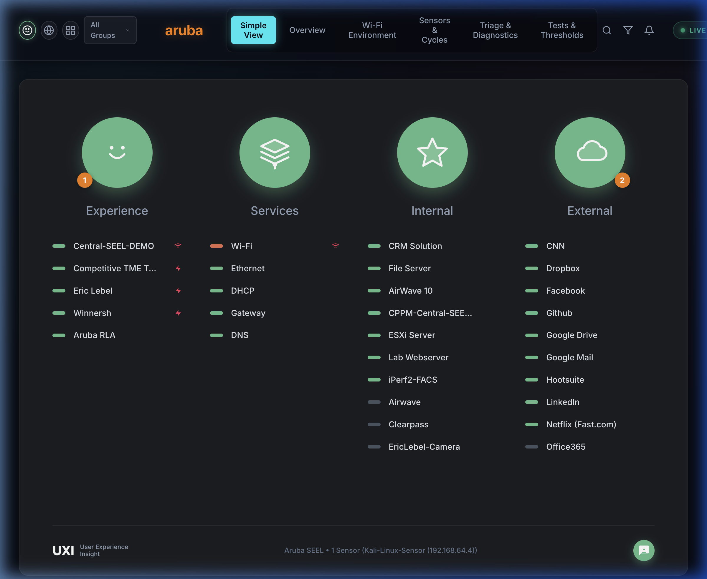
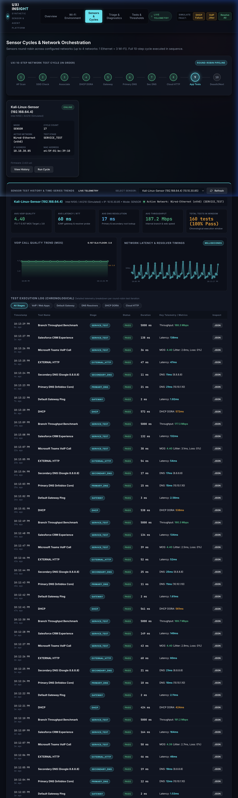

# Pulse UX — Digital Experience Monitoring & Synthetic Network Telemetry

<div align="center">
  
  <p><strong>Pulse UX Sensor</strong> (Client Daemon) • <strong>Pulse UX Hub</strong> (Server & Web Telemetry Platform)</p>
  <p><em>Enterprise IT Infrastructure & DevSecOps Digital Experience Monitoring</em></p>
</div>

---

A modern, self-hosted, enterprise-grade synthetic network telemetry platform featuring:
- **Pulse UX Sensor**: Linux sensor & passive agent daemon executing a continuous 10-step network diagnostic cycle.
- **Pulse UX Hub**: Central management hub with PostgreSQL time-series storage, AIOps incident correlation engine, real-time Server-Sent Events (SSE), and a dark glassmorphic dashboard with the iconic 4-pillar Simple View.

---

## 📸 Platform Views

| Pulse UX Simple View | Real-Time Fleet & Telemetry Overview |
| :---: | :---: |
|  |  |

| Historical Diagnostic Trends & KPI Aggregates |
| :---: |
|  |

---

## ⚡ Key Architecture & Capabilities

### 1. Pulse UX Sensor (Client)
- **Sensor Mode**: Takes control of a dedicated Wi-Fi test interface (e.g., Intel AX210 or MediaTek MT7921AU) and/or wired Ethernet to execute a continuous **10-step round-robin test cycle**:
  1. **AP Scan**: BSSIDs, RSSI, SNR, channel utilization, QBSS client counts.
  2. **SSID Check**: Verifies that configured SSIDs are actively beaconing.
  3. **AP Association**: Direct `wpa_supplicant` timing measurement.
  4. **Allocate IP (DHCP)**: Full DORA cycle timing and lease acquisition.
  5. **Gateway Reachability**: ICMP ping and ARP latency.
  6. **Primary DNS**: Resolves internal control hosts (e.g. Infoblox / Active Directory DNS).
  7. **Secondary DNS**: Resolves public resolver (e.g. Google 8.8.8.8 / Cloudflare 1.1.1.1).
  8. **External Connectivity**: HTTP GET check to cloud endpoints.
  9. **Application & Service Tests**:
     - **VoIP MOS**: ITU-T G.107 E-Model MOS calculation (1.0 – 5.0) derived from jitter, latency, and packet loss.
     - **Webserver / SaaS**: HTTP status, response latency, and TLS SSL certificate expiration monitoring (Salesforce, Microsoft 365, internal portals).
     - **Throughput**: iPerf3 bandwidth benchmarking.
  10. **Release & Deauth**: Releases lease and advances to the next configured network.
- **Agent Mode**: Passive non-disruptive daemon for employee endpoints; skips Wi-Fi churn and tests gateway, DNS, and applications on a 5-minute schedule.
- **Store-and-Forward**: Local persistent queue buffers test telemetry if server/backhaul connectivity drops, auto-flushing upon restoration.
- **Automated Root-Cause Triage**: In-line failure replayer capturing traceroute hops, raw Linux terminal command traces (`iw`, `dhclient -v`, `dig`), and cross-checks.

### 2. Pulse UX Hub (Server & Dashboard)
- **Time-Series Storage**: PostgreSQL schema storing sensors, networks, test definitions, metrics, issues, incidents, and triage dumps.
- **Dual-Mode Database**: Connects to native PostgreSQL (`pg.Pool`) via `DATABASE_URL`, or runs embedded PostgreSQL WASM (`@electric-sql/pglite`) for zero-dependency instant local development.
- **Threshold Engine**: Evaluates metrics against enterprise SLAs (DHCP > 2s, DNS > 100ms, MOS < 3.8).
- **AIOps Incident Engine**: Correlates isolated threshold breaches (Blue Issues) across sensors and networks into high-level environmental impacts (Red Incidents).
- **Real-Time Telemetry Pipeline**: Server-Sent Events (SSE) stream live sensor cycle progression and metric updates without full-page reloads.
- **Modern Glassmorphic Dark-Mode UI**:
  - **4-Pillar Simple View**: Experience (perception face), Services (network layers), Internal (intranet & core infrastructure), and External (cloud/SaaS apps).
  - Animated SVG **Experience Score Donut** (0–100).
  - Multi-band **2.4 GHz / 5 GHz / 6 GHz (Wi-Fi 6E)** RF spectrum channel heatmaps and AP vendor identification.
  - Interactive **10-Step Cycle Visualizer**.
  - **Diagnostic Terminal Emulator** with raw diagnostic traces and hop path analysis.
  - **Sensor History View**: Time-series latency charts, packet loss bars, and detailed metric breakdown.

---

## 🚀 Quickstart (Local Development & Demo)

### 1. Start Pulse UX Hub
```bash
# Clone the repository
git clone https://github.com/mariobaryshore2022-beep/UXI-Clone.git pulse-ux
cd pulse-ux

# Install dependencies
npm install

# Start Pulse UX Hub (runs on port 3000 with auto-migrating embedded PostgreSQL)
npm run hub
```
Open your browser to: **[http://localhost:3000](http://localhost:3000)**

### 2. Run Pulse UX Sensor
In a separate terminal:
```bash
# Run in simulation mode (ideal for macOS, WSL, or non-root development)
npm run sensor:simulate

# Or run in passive agent mode
npm run sensor:agent
```

---

## 🐧 Hardware Deployment on Ubuntu / Debian / Kali Linux

Recommended target hardware: **Intel N100 mini PC** with **Intel AX210** (Wi-Fi 6E M.2 card) or **Raspberry Pi 5** with **MediaTek MT7921AU** USB adapter.

### One-Line Automated Setup
Run the setup script with root permissions:
```bash
sudo bash client/install-ubuntu.sh wlan1 http://<PULSE_UX_HUB_IP>:3000
```
This automated installer:
1. Installs native packages: `iw`, `wpasupplicant`, `isc-dhcp-client`, `iperf3`, `mtr-tiny`, `tcpdump`, `dnsutils`.
2. Marks the test interface (`wlan1`) as **unmanaged** in `/etc/NetworkManager/conf.d/99-pulse-sensor-unmanaged.conf` so management traffic stays intact on `eth0`.
3. Installs and starts the systemd service `/etc/systemd/system/pulse-sensor.service`.

Check sensor service status:
```bash
sudo systemctl status pulse-sensor
sudo journalctl -u pulse-sensor -f
```

---

## 🐳 Docker Compose Deployment (Pulse UX Hub + PostgreSQL)

To deploy Pulse UX Hub with a dedicated PostgreSQL 16 container:

```bash
docker compose up -d
```

This starts:
- `pulse-postgres`: PostgreSQL 16 container with persistent volume `pulse_pg_data` on port `5432`.
- `pulse-ux-hub`: Node.js backend & dashboard container on port `3000`.

---

## 📡 REST API Reference

| Endpoint | Method | Description |
|---|---|---|
| `/api/overview` | `GET` | Experience score, online sensors, active incidents & issues |
| `/api/sensors` | `GET` | List of sensors, hardware info, active stage, cycle count |
| `/api/sensors/register` | `POST` | Sensor heartbeat and registration |
| `/api/telemetry/stage` | `POST` | Sensor cycle stage update (`ap_scan`, `dhcp`, etc.) |
| `/api/telemetry/results` | `POST` | Ingest test results; triggers threshold & incident engine |
| `/api/telemetry/history` | `GET` | Historical test results and KPI aggregates for a sensor |
| `/api/telemetry/wifi` | `GET`/`POST`| Ingest / query 2.4/5/6 GHz Wi-Fi environment telemetry |
| `/api/issues` | `GET` | List active SLA threshold violations (Blue) |
| `/api/incidents` | `GET` | List AIOps correlated incidents (Red) |
| `/api/triage` | `GET`/`POST`| Ingest / inspect automated root-cause triage reports |
| `/api/triage/:id` | `GET` | Fetch specific triage report with terminal output and hops |
| `/api/simulate-degradation` | `POST` | Fault injection (`dhcp_timeout`, `voip_jitter`, `clear`) |
| `/api/events` | `GET` | Real-time Server-Sent Events (SSE) telemetry stream |

---

## 🔬 ITU-T G.107 VoIP MOS Formula

Pulse UX Sensor implements the standard telecommunications transmission rating factor:
$$R = 93.2 - I_d - I_e$$
where $I_d$ is the delay impairment factor (one-way delay = $\text{RTT}/2 + 2 \times \text{jitter}$) and $I_e$ is the equipment packet loss impairment factor:
$$I_e = 30 \ln\left(1 + 15 \times \frac{P_{\text{loss}}}{100}\right)$$
The resulting Mean Opinion Score (MOS) is mapped to standard 1.0 – 4.5 boundaries:
$$\text{MOS} = 1 + 0.035 R + R(R - 60)(100 - R) \times 7 \times 10^{-6}$$
Scores $\ge 3.8$ indicate enterprise-grade voice transmission.
