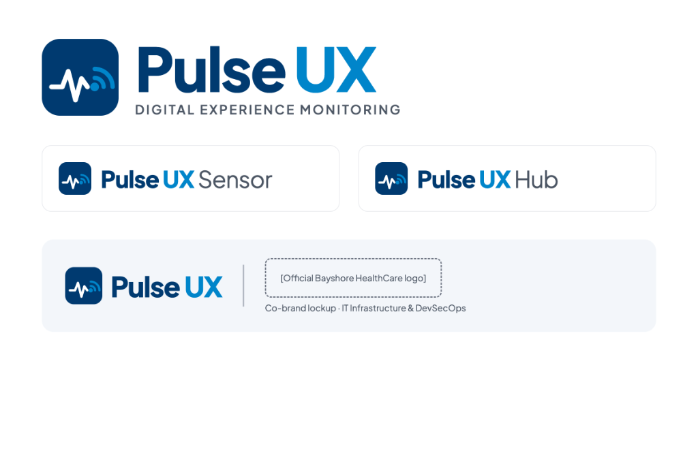

# Pulse UX — Digital Experience Monitoring (DEM) Architecture & Build Specification

<div align="center">
  
  <p><strong>Pulse UX Sensor</strong> (Client Daemon) • <strong>Pulse UX Hub</strong> (Server & Web Telemetry Platform)</p>
  <p><em>Bayshore HealthCare — IT Infrastructure & DevSecOps</em></p>
</div>

---

## 0. Project Brief & Core Architecture

- **Pulse UX Sensor (Client)**: A resilient Linux service that executes synthetic network, wireless, and application tests continuously from the end-user's vantage point, reporting telemetry back to Pulse UX Hub.
  - **Sensor Mode**: Owns a dedicated network test interface (Wi-Fi 6E / Ethernet); executes the full synthetic diagnostic cycle including RF scanning, 802.11 association, and DHCP negotiation.
  - **Agent Mode**: Runs non-disruptively in the background on employee laptops/workstations; performs application and passive performance tests on a 5-minute interval without dropping user connections.
- **Pulse UX Hub (Server & Platform)**: Ingestion API + PostgreSQL time-series storage + SLA threshold engine + AIOps incident correlation engine + dark glassmorphic telemetry dashboard + webhooks & data push workers.
- **Target OS**: Ubuntu Server LTS (24.04 / 26.04 with HWE kernel) or Debian 13.
  > *Note on Validation Lab*: Kali Linux ARM64 (e.g., `192.168.64.4`) is used as an active validation sandbox, with standard Ubuntu/Debian serving as the production appliance deployment target.
- **Hardware Platforms**:
  - *Lab / POC*: Linux host or VM with dedicated management and test network interfaces.
  - *Production Fleet*: Intel N100 mini PC with Intel AX210 Wi-Fi 6E M.2 module (preferred x86 appliance) or Raspberry Pi 5 with MediaTek MT7921AU USB adapters.

---

## 1. Pulse UX Platform Architecture

The system consists of three coordinated tiers: **Pulse UX Sensors** (dedicated hardware probes), **Pulse UX Agents** (endpoint software agents), and **Pulse UX Hub** (central telemetry and analytics engine).

- **Probes**: Deploy near critical end users, clinical stations, and high-density zones.
- **Continuous Diagnostics**: Scaled to process upwards of 20,000 synthetic test cycles per day per sensor.
- **Store-and-Forward**: Local persistent disk queue guarantees zero telemetry loss during backhaul or server outages.

---

## 2. Sensor Network Configuration Model

- **Up to 4 Networks per Sensor**: Supports 1 Wired Ethernet interface (`eth0`) plus up to 3 Wi-Fi SSIDs simultaneously.
- **IP Assignment**: Configurable for dynamic DHCP (full DORA negotiation) or static IP addressing per network.
- **Proxy Awareness**: Full support for manual proxies, WPAD, and PAC files, with explicit flags to force ICMP/TCP pings when a proxy is active.
- **External Connectivity Toggle**: Allows suppression of external SaaS tests and external SLA alerts on isolated clinical or internal VLANs.
- **Dual-Stack**: Native IPv4 and IPv6 diagnostic validation.

---

## 3. Pulse UX Core 10-Step Test Cycle

Each configured network is tested in a strict round-robin sequence:

1. **AP Scan**: Discovers neighboring BSSIDs, RSSI, SNR, and channel utilization.
2. **SSID Check**: Confirms target enterprise SSIDs are actively beaconing.
3. **AP Association**: Direct `wpa_supplicant` timing measurement.
4. **Allocate IP (DHCP)**: Full DORA cycle (Discover, Offer, Request, Acknowledge) timing measurement and lease renewal.
5. **Gateway Reachability**: ICMP ping and ARP latency to local gateway.
6. **Primary DNS**: Host resolution timing against internal DNS servers (e.g. Infoblox / Active Directory).
7. **Secondary DNS**: Host resolution timing against secondary / upstream resolvers (e.g. `8.8.8.8` / `1.1.1.1`).
8. **External Connectivity**: HTTP GET check to cloud control endpoints.
9. **Service & Application Tests**:
   - Internal enterprise targets (EHR portal, intranet, core databases).
   - External cloud targets (Microsoft 365, Teams, Salesforce, AWS).
   - VoIP MOS synthetic voice benchmarking (ITU-T G.107).
   - Throughput benchmarking (iPerf3 / Librespeed).
10. **Release & Deauth**: Releases IP lease, closes test interface, and advances to the next configured network.

---

## 4. Service & Application Tests

Synthetic tests are classified as **Internal** (LAN/intranet) or **External** (internet/cloud), each with custom execution frequencies and rate limits:

| Test Template | Diagnostic Behavior |
|---|---|
| **Generic Port / ICMP** | Target IP/FQDN; up to 4 TCP ports + ICMP; 20 packets per TCP port + 20 ICMP per round. Validates core infrastructure. |
| **Webserver / HTTP(S)** | HTTP/HTTPS GET on standard or custom ports; parses status code; validates TLS/SSL certificate validity and expiration dates. |
| **VoIP MOS (Voice Quality)** | Single TCP/UDP port (e.g., 443/5060); 100 packets; measures one-way latency, jitter, and packet loss → converts to ITU-T G.107 MOS (1.0–5.0). |
| **Telnet / SSH Reachability** | Connects to port, waits for defined prompt string; measures connection latency and handshake errors. |
| **iPerf3 Throughput** | Multi-stream TCP/UDP upload and download throughput testing to private or public iPerf servers. |
| **Librespeed** | Upload/download bandwidth, ping latency, and jitter against private or public Librespeed speedtest servers. |
| **Web Application Test (WAT)** | Replays scripted web transaction recordings: login, navigation, data submission, logout. Tracks per-step timing and failure screenshots. |
| **Captive Portal** | Replays interactive captive-portal workflows (RFC 8908/8910 discovery). |

### Mathematical Model: ITU-T G.107 VoIP MOS

Pulse UX Sensor computes the telecommunication transmission rating factor ($R$):
$$R = 93.2 - I_d - I_e$$
Where $I_d$ is the delay impairment factor (one-way delay = $\text{RTT}/2 + 2 \times \text{jitter}$) and $I_e$ is the equipment packet loss impairment factor:
$$I_e = 30 \ln\left(1 + 15 \times \frac{P_{\text{loss}}}{100}\right)$$
The resulting rating factor $R$ maps to the standard 1.0 – 4.5 Mean Opinion Score:
$$\text{MOS} = 1 + 0.035 R + R(R - 60)(100 - R) \times 7 \times 10^{-6}$$
*Scores $\ge 3.8$ represent enterprise-grade voice transmission.*

---

## 5. Wireless RF Telemetry & Spectrum Analysis

- **Scan Metrics**: BSSID, SSID, band (2.4 GHz, 5 GHz, 6 GHz Wi-Fi 6E), channel, channel width, RSSI (dBm), SNR (dB), and channel utilization percentage.
- **Multivendor AP Identification**: Inspects vendor Information Elements (IEs) from beacon frames to identify Cisco, Mist, Extreme, and Enterprise APs.
- **QBSS IE Inspection**: Extracts available admission capacity, channel utilization, and active client counts directly from beacon frames.
- **Off-Band Monitoring (Phase 2)**: Secondary radio in monitor mode cycles through BSSIDs to track frame-type distributions, 802.11 retry rates, and roaming transitions.

---

## 6. Automated Triage & Root-Cause Diagnostics

When any synthetic test fails:
1. **In-Line Replayer**: The sensor immediately pauses round-robin stepping to replay the failing diagnostic sequence.
2. **Context Enrichment**: Captures active BSSID, signal strength, channel utilization, and interface state.
3. **Trace Path Analysis**: Executes MTR/traceroute to identify the exact hop where latency spiked or packets dropped.
4. **Wired Cross-Check**: If Wi-Fi fails while Ethernet is active, the test re-runs over Ethernet to isolate RF anomalies from upstream infrastructure failures.
5. **Terminal Command Trace**: Dumps exact command outputs (`iw dev`, `dhclient -v`, `dig +trace`, `ping -c 5`) for one-click plain-text export.

---

## 7. Pulse UX Hub Analytics & AIOps Incident Engine

- **Threshold Violations (Blue Issues)**: Triggered when a telemetry metric breaches configured SLAs (e.g., DHCP > 2s, DNS > 100ms, MOS < 3.8) across a moving evaluation window.
- **AIOps Correlated Outages (Red Incidents)**: Aggregates isolated threshold issues occurring across multiple sensors, networks, or services into correlated incidents.
- **4-Pillar Simple View**:
  1. **Experience**: Real-time perception status (Good / Degraded / Critical).
  2. **Services**: Core network infrastructure (Wi-Fi association, DHCP, Gateway, DNS).
  3. **Internal**: Enterprise infrastructure (Intranet, Active Directory, EHR systems).
  4. **External**: Cloud services and SaaS applications (Salesforce, Microsoft 365, Teams).

---

## 8. Webhooks & Real-Time Alerting

- **Real-Time Telemetry Pipeline**: Server-Sent Events (`/api/events`) stream live cycle progress, stage shifts, and test results without polling.
- **Outbound Webhooks**: Dispatches JSON payloads to Microsoft Teams workflows, Slack incoming webhooks, or generic IT service management (ITSM) webhooks.
- **Alert Suppression**: Webhooks can notify on every raw issue or only on correlated Red Incidents.

---

## 9. Hardware Sizing & Bill of Materials

### Intel N100 Mini PC (Recommended Appliance)
- **CPU / RAM**: Intel Alder Lake-N N100 (4 cores, up to 3.4 GHz), 8 GB DDR4/DDR5 RAM, 128 GB M.2 NVMe SSD.
- **Wireless**: Intel AX210 M.2 Key-E (Wi-Fi 6E 802.11ax tri-band, native Linux `iwlwifi` support).
- **Secondary Radio**: MediaTek MT7921AU USB 3.0 dongle (kernel 6.x `mt7921u` driver).
- **Power**: 12V DC input (compatible with PoE-to-12V active splitters).

### Raspberry Pi 5 (Alternative Compact Appliance)
- **Base**: Raspberry Pi 5 (4 GB RAM model).
- **Client Radio**: MediaTek MT7921AU USB adapter.
- **Power**: Official Raspberry Pi PoE+ HAT.
- **Storage**: M.2 NVMe HAT with 128 GB high-endurance NVMe drive.

---

## 10. Open-Source Linux Tool Mapping

| Pulse UX Capability | Underlying Linux Implementation |
|---|---|
| AP scan / SSID check | `iw dev <iface> scan`, `nl80211` netlink kernel interface |
| Association timing | `wpa_supplicant` control socket (`wpa_cli`) |
| DHCP timing + DORA trace | `dhclient -v`, `udhcpc`, or `isc-dhcp-client` |
| Gateway / Ping / Port check | ICMP socket + asynchronous TCP connect timers |
| DNS resolution | Native Node.js `dns.promises` or `dig` / `dnspython` |
| Webserver + SSL Cert check | Native HTTP/HTTPS requests + TLS socket cert expiration extraction |
| VoIP MOS | Synthetic UDP jitter/loss calculation $\rightarrow$ ITU-T G.107 model |
| Throughput | `iperf3`, `librespeed-cli` |
| Web Transaction Tests | Headless Chromium / Playwright script runner |
| Root-Cause Triage | `mtr-tiny`, `traceroute`, `tcpdump` |
| Local Telemetry Queue | `storeAndForward.js` disk-persisted FIFO buffer |
| Hub Backend | Express.js, PostgreSQL / PGlite WASM, Server-Sent Events (SSE) |

---

## 11. Fleet Configuration & Settings Schema

```
Pulse UX Hub Settings Navigation:
├── Networks (Wireless & Wired)
│   ├── SSID / Network Name & Alias
│   ├── Security (Open, WPA2-PSK, WPA3-SAE, 802.1X Enterprise)
│   ├── EAP Method (PEAP, EAP-TLS with CA / Client Cert)
│   ├── Band Locking (Auto, 2.4 GHz, 5 GHz, 6 GHz)
│   └── Proxy & External Connectivity Toggles
├── Service & App Tests
│   ├── Internal / External Test Selection
│   ├── Execution Frequency (10s, 1m, 5m, 15m, 1h)
│   └── Fleet-Wide Rate Limiting
├── Sensors & Assignments
│   ├── Group / Hierarchy Assignment (e.g. "HQ-Campus", "Floor-3")
│   └── Network & BSSID Lock Overrides
├── SLA Thresholds
│   ├── Warning & Error Latency Thresholds
│   └── MOS Quality Targets (Target MOS ≥ 3.8)
└── Integrations & Alerts
    ├── Microsoft Teams / Slack Webhook Endpoints
    └── External Time-Series Data Export
```

---

## 12. Standard Telemetry Payload Schemas

### Test Result Ingestion (`POST /api/telemetry/results`)

```json
{
  "sensor_id": "sensor-kali-arm64",
  "network_id": "net-wired-eth0",
  "network_name": "Wired-Ethernet (eth0)",
  "test_code": "VOIP_MOS",
  "category": "internal",
  "status": "passed",
  "duration_ms": 142,
  "metrics": {
    "latency_ms": 12.4,
    "jitter_ms": 1.8,
    "packet_loss_pct": 0.0,
    "mos": 4.41
  },
  "context": {
    "ip_address": "192.168.64.4",
    "gateway": "192.168.64.1",
    "dns_server": "192.168.64.1",
    "interface": "eth0"
  },
  "timestamp": "2026-10-21T21:55:00.000Z"
}
```

### Complete Issue Code Catalog

| Domain | Issue Codes |
|---|---|
| **RF & Association** | `LOW_RSSI`, `LOW_BITRATE`, `HIGH_RETRY_RATE`, `HIGH_CHANNEL_UTILISATION`, `WIFI_ASSOCIATION_FAILED`, `WIFI_SSID_MISSING`, `WIFI_AUTHENTICATION_FAILED`, `WIFI_4WAY_HANDSHAKE_FAILED` |
| **802.1X & Certs** | `8021X_AUTHENTICATION_FAILED`, `8021X_TIMEOUT`, `8021X_UNKNOWN_CA`, `SCEP_SERVER_NO_RESPONSE` |
| **DHCP & Routing** | `HIGH_DHCP_RESPONSE_TIME`, `DHCP_FAILURE`, `DHCP_NO_OFFERS`, `DHCP_NO_GATEWAY`, `GATEWAY_UNREACHABLE`, `NO_ETHERNET_CARRIER` |
| **DNS** | `HIGH_DNS_RESPONSE_TIME`, `DNS_FAILURE`, `DNS_UNREACHABLE`, `PRIMARY_DNS_FAILURE`, `SECONDARY_DNS_FAILURE` |
| **Voice & Latency** | `HIGH_LATENCY`, `HIGH_JITTER`, `HIGH_LOSS`, `LOW_INTERNAL_VOIP_MOS`, `LOW_EXTERNAL_VOIP_MOS` |
| **Web & Applications** | `SERVICE_UNAVAILABLE`, `HTTP_STATUS_CODE_ERROR`, `SSL_CERT_EXPIRING`, `WEB_APP_TIMEOUT`, `WEB_APP_STEP_FAILED` |
